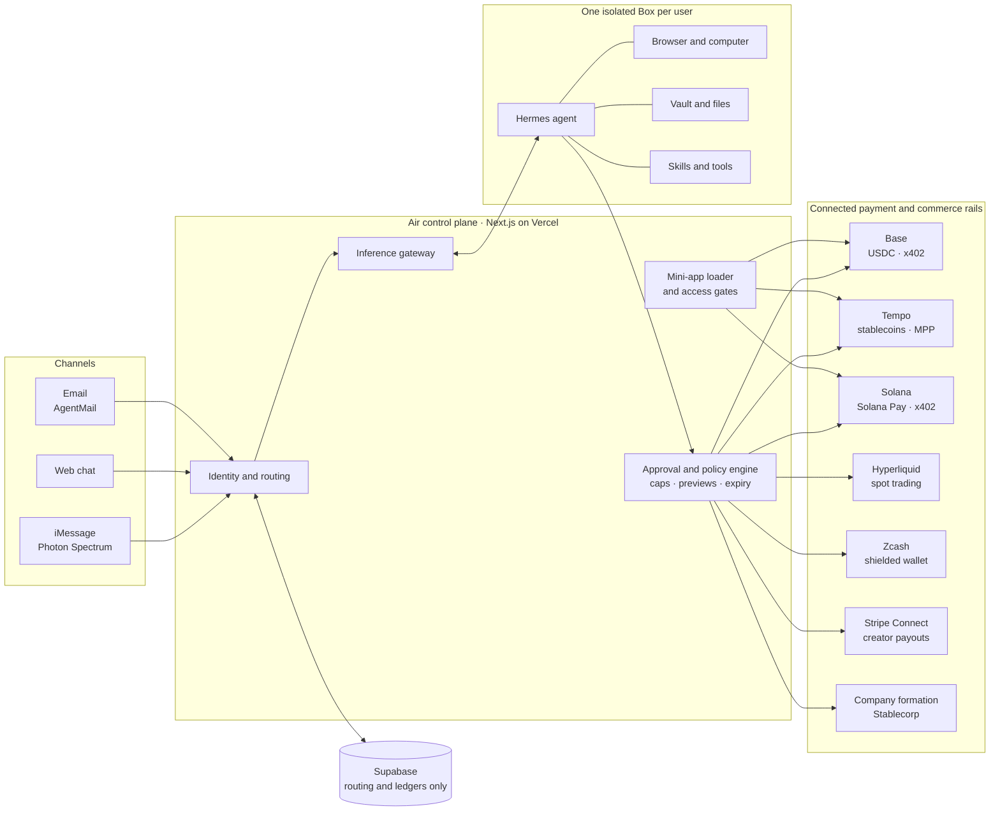

# Air

**A private AI agent with its own phone number, inbox, computer, and wallet—built for one person.**

Air lives in iMessage. Text it like a trusted assistant: it can triage email, manage your calendar, use a cloud computer, create images and video, run a storefront, and help move money. When a task needs your input, Air brings an interactive card or mini-app into the conversation.

Air is built for creators and entrepreneurs managing creative work and cash flow without a large team—from musicians getting paid after a show to founders building their first company.

**Status:** Private beta

## What Air can do

| You ask | Air does |
| --- | --- |
| “Draft a reply to the brand deal email and hold Thursday afternoon.” | Drafts a reply for your approval and proposes a calendar hold. |
| `/imagine three cover options for the new single` | Generates images in its creative studio. |
| “Turn the tour poster into a $25 listing.” | Stages a storefront listing for your approval. Buyers pay through Stripe Connect. |
| “Order 20 blank tees in size M, cheapest option.” | Shops in its browser and stops before checkout. |
| `/trade buy $50 of BTC` | Previews an order and waits for your approval before execution. Paper trading starts with $10,000 simulated funds. |
| `/inbox`, `/calendar`, `/vault`, `/shop`, `/pay`, `/trade` | Opens the matching mini-app in the conversation. |

Approvals can arrive as an iMessage card, in the **Needs you** panel at `app.wzrd.tech/home`, or through a short-lived approval link. Mini-apps run at `mini.wzrd.tech`; creators can publish apps and charge per open with x402.

## Architecture

The diagram shows the connected architecture across Air’s channels, isolated agent environment, approval flow, and payment rails. Availability by rail is listed below.



### System components

| Component | Role |
| --- | --- |
| **Channels** | iMessage and web chat share a user session; email is thread-scoped. |
| **Control plane** | Routes messages, applies trust tiers, gates approvals, and serves mini-apps. |
| **The Box** | A user’s isolated Linux computer, running Hermes, browser, vault, files, and skills. |
| **Shared state** | Supabase stores routing and ledgers, not user messages, memory, or documents. |
| **Identity and money** | Base wallets, Stripe Connect, x402, and connected service integrations. |

## Crypto rails

One approval flow can support multiple payment and commerce rails. The diagram shows the intended connected architecture; rollout status is shown here.

| Rail | Use case | Status |
| --- | --- | --- |
| **Base** | User wallets, staged USDC payments, and x402 payments for creator mini-apps. | Live |
| **Tempo** | Stablecoin invoices with transfer memos and sponsored fees; MPP machine payments for mini-apps. | Next |
| **Solana** | Solana Pay QR codes for gigs and merch, plus a Solana x402 option for mini-apps. | Next |
| **Hyperliquid** | Approval-gated spot trading through an API wallet that cannot withdraw. | Next |
| **Zcash** | A shielded wallet on the user’s Box, with owner approval required to send. | Next |
| **Company formation** | A guided path from entity choice to company and bank account through Stablecorp. | Next |

“Next” means specified and testnet-first, but not yet merged.

- [Worlds Fair overview](docs/worlds-fair/README.md): tracks and considered options
- [Worlds Fair specification](docs/worlds-fair/spec.md): sessions, migrations, and acceptance criteria
- [Recommendations](docs/worlds-fair/recommendations.md): research behind the specification
- [Public documentation pages](docs/site/index.md): pages for `air.wzrd.tech/docs`

## Security and user control

Air is designed around a simple rule: an agent that can access private information or prepare financial actions must keep the user in control.

- **One person, one agent, one computer.** Each user’s agent runs in an isolated Box.
- **Private content stays in the Box.** The shared database stores routing and ledger data, not messages, memory, or documents.
- **Actions wait for approval.** Payments, trades, purchases, and publishing actions can be prepared by the agent, but require an exact, expiring approval before execution. Spending caps are user-controlled, and only one approval can be pending at a time.
- **Provider keys stay in the control plane.** Connected exchange and provider keys are sealed and never passed to the agent or its browser. The agent’s email key can draft only.
- **External content is untrusted.** Email, messages, web pages, and calendar invitations are treated as potentially hostile input.
- **Inbound access is restricted.** The agent makes outbound connections; inbound access goes through Air’s authenticated control plane.

## Documentation

- [Platform guide](docs/platform.md): deployment, lifecycle, channels, gateway, sandboxes, and security
- [Project plan](goal.md): executable milestones
- [Architecture](ARCHITECTURE.md): system design and rationale
- [System map](docs/architecture/air-system-map.html): code-verified diagram of every component, eight mechanism figures, and image-model prompts ([PNG](docs/architecture/air-system-map.png), [prompts](docs/architecture/sunburst-prompt.md))
- [Security decisions](SECURITY-DECISIONS.md): security posture and decisions
- [Commerce](docs/commerce-zaps.md): storefront listings, approval, and Stripe Connect
- [Trading plan](docs/trade/plan.md): approval-gated trading rails
- [Trading tape](docs/trade/tape.md): trading interface
- [Create v11](docs/goal-create-v11.md) and [Create v12](docs/goal-create-v12.md): creative workflows and production on `mini.wzrd.tech`

## Repository layout

```text
apps/web/                      Next.js control plane and UI
  app/home/                    Dashboard and user tools
  app/mini/[app]/              Mini-apps and token exchange
  app/api/inbound/             Email, iMessage, and calendar webhooks
  app/api/gateway/             OpenAI-compatible inference gateway
  app/api/box/                 Allowlisted Hermes dashboard proxy
  lib/box/                     Box lifecycle and command wrappers
  lib/hermes/                  Hermes API client, sessions, and approvals
  lib/routing/                 Address, user, Box, and trust-tier routing
  lib/miniapps/                Mini-app registry, loader, gates, and cards
  lib/trade/                   Trading venues, previews, and tape
  lib/wallet/                  Wallet and payment integrations
  lib/vault/                   Vault metadata, fill tickets, and log scrubbing
supabase/migrations/           Forward-only SQL migrations
infra/template/                Box image, Hermes, browser, and base skills
.agents/skills/                Pinned developer-agent skills
scripts/                       Operator runbooks
docs/                          Platform guides, plans, specs, and public docs
```

## Development

```bash
npm install
npm run dev
npm run typecheck
npm run lint
npm run test
```

Environment variables are documented in `goal.md` §5 and declared in `apps/web/lib/env.ts`. Secrets are server-side; the app does not use `NEXT_PUBLIC_` secrets.

## Project conventions

- TypeScript strict mode; no `any` in `lib/`.
- Route Box and Hermes calls through `lib/box/` and `lib/hermes/`.
- Resolve money actions through the approval decision resolver.
- Include idempotency coverage when adding an inbound webhook.
- Include `user_id` and `box_id` in structured logs that touch a Box.
- Keep migrations numbered and forward-only; never edit an applied migration.
- Commit subjects identify a finding (`R-XXX-01: …`) or start with `chore:`. CI enforces this convention.
